# agent-starter

基于 **NestJS + Vue 3** 的 AI 旅游助手 monorepo：结构化 POI 检索 + RAG 知识库增强，SSE 流式对话，支持 **Mock 模式**（无需 cursor-agent 即可完整演示）。

## 项目亮点（面试向）

| 亮点 | 说明 |
|------|------|
| **双轨检索** | POI 工具链（SQL 结构化）+ RAG 文档检索（攻略长文本）并行，合并注入 prompt |
| **SSE 流式** | 自研 `createSseSession`：心跳保活、delta 增量、TCP_NODELAY 防缓冲 |
| **RAG 实践** | SQLite 分块 + LIKE + **按城市分区 TF-IDF 向量**混合检索（RRF 融合），支持多城市 lazy 索引 |
| **可演示** | `MOCK_AGENT=true` + Docker Compose 一键启动 |
| **工程化** | **pnpm workspace** + **Turborepo** + `packages/shared` 类型包、ESLint、Jest（含 Supertest 集成测）、Playwright E2E、GitHub Actions、Docker / Render、Swagger `/api/docs` |
| **账号与记忆** | Google GIS + HttpOnly JWT Cookie；用户 Markdown 旅行记忆（规则抽取）；会话按 `user_id` 隔离 |

更详细的 RAG 见 [docs/RAG.md](docs/RAG.md)，部署见 [docs/DEPLOY.md](docs/DEPLOY.md)，**面试口述与简历对齐**见 [docs/INTERVIEW.md](docs/INTERVIEW.md)。

## 账号、游客与旅行记忆

| 能力 | 登录用户 | 游客（「游客进入」） |
|------|----------|----------------------|
| SSE 聊天 | ✅ | ✅ |
| 会话列表 / 创建 / 删除 | ✅ | ❌（API 需 JWT） |
| 旅行记忆读写 | ✅ `user_memory.content_md` | ❌ |
| 鉴权 | Cookie `auth_token` | 无 Cookie，仅 `sessionStorage.travel_guest` 进 `/app` |

- **登录**：Google One Tap / 按钮 → `POST /api/auth/google`；本地可用 `POST /api/auth/dev-login`（见 `.env.example`）。
- **记忆**：每条用户消息在 `streamTravelChat` 开头触发规则抽取合并 Markdown，再注入 prompt；**不落磁盘 `.md 文件`**，存 SQLite。
- **前端**：全局顶栏 `AppTopBar` 展示账号 / 登录；路由 `ensureAuthLoaded` + 游客标记。

**团队 Google 登录**：全组共用一个 Web Client ID → 写入 `config/google-oauth.team.json`（可提交 Git）；前端只读 `GET /api/auth/config`。流程见 [docs/GOOGLE_AUTH.md](docs/GOOGLE_AUTH.md)。私密项：`JWT_SECRET`、`AUTH_ALLOW_DEV_LOGIN`、`AUTH_GOOGLE_INSECURE_LOCAL_JWT`（仅开发）。

## 快速开始

```bash
corepack enable   # Node 自带包管理器切换器
corepack install  # 按根 package.json 的 "packageManager" 安装/钉扎 pnpm（当前 pnpm@10.34.9）
nvm use           # .nvmrc → Node 22；安装与 pnpm dev 请用同一主版本
pnpm -v           # 应与 packageManager 一致
pnpm install      # postinstall 会为当前 Node 编译 better-sqlite3
# 仍报 ERR_DLOPEN_FAILED：nvm use 22 && node scripts/ensure-better-sqlite3.mjs
cp .env.example .env   # 默认 MOCK_AGENT=true，开箱可跑
# packages/data/travel.db 已预置；缺失时运行 pnpm db:init

pnpm dev        # 后端 :3300，前端 :5173
pnpm test       # turbo run test
pnpm test:e2e   # Playwright E2E
pnpm build
pnpm start

# Docker 一键启动（Mock 模式，适合 demo / 部署）
pnpm docker:up
```

### Docker / 在线 Demo

```bash
docker compose up --build   # 或 pnpm docker:up
# 访问 http://localhost:3000
```

部署到 Render：见 [docs/DEPLOY.md](docs/DEPLOY.md)（含 `render.yaml` Blueprint）。

### 两种运行模式

| 模式 | 配置 | 适用场景 |
|------|------|----------|
| **Mock（推荐 demo）** | `MOCK_AGENT=true` | 面试演示、CI、无 Cursor CLI |
| **真实 Agent** | `MOCK_AGENT=false` + `cursor-agent login` 或 API Key | 完整 AI 体验 |

真实 Agent 认证（二选一）：

```bash
cursor-agent login
# 或在 .env 中设置 CURSOR_USE_API_KEY=true 和有效的 CURSOR_API_KEY
```

## 项目结构

```
agent-starter/
├── apps/
│   ├── backend/      # NestJS API、SSE、SQLite、RAG、Swagger /api/docs
│   └── frontend/     # Vue 3 三栏 UI（Vite alias → shared 源码）
├── packages/
│   ├── shared/       # @agent-starter/shared — 前后端共享 TS 类型
│   ├── data/         # 预置 travel.db（@agent-starter/data）
│   └── e2e/          # Playwright
├── config/           # google-oauth.team.json（团队公开 Client ID，可提交）
├── turbo.json        # Turborepo（build 含 ^shared）
├── eslint.config.mjs # 根 ESLint（TS）
├── docs/GOOGLE_AUTH.md
├── docs/MONOREPO.md  # 共享包、缓存、迁 PG、Remote Cache
└── .env
```

### Monorepo（pnpm workspace + Turborepo）

| 命令 | 说明 |
|------|------|
| `pnpm build` | `turbo run build` — **先 `@agent-starter/shared` → frontend / backend** |
| `pnpm lint` | `turbo run lint` |
| `pnpm test` | `turbo run test`（含 Supertest 集成测） |
| `pnpm dev` | concurrently；工作区包用 `pnpm --filter backend` |
| `pnpm exec turbo run lint test build --summarize` | **CI**（`--frozen-lockfile` 安装） |

仓库内：`pnpm-workspace.yaml`、`.npmrc`（`shamefully-hoist` 便于 Nest/native 模块）。

**面试可讲**：`packages/shared` 单一类型源；`^build` 拓扑；OpenAPI 见 **http://127.0.0.1:3000/api/docs**；Remote Cache 见 [docs/MONOREPO.md](docs/MONOREPO.md)。

## 数据库结构（SQLite）

预置库路径：`packages/data/travel.db`。Schema 定义见 [`apps/backend/src/travel/database/schema.ts`](apps/backend/src/travel/database/schema.ts)。**改表结构后执行 `pnpm db:init` 并提交新 db**；后端启动不会自动迁移旧库。

### 领域划分

| 领域 | 表 | 用途 |
|------|-----|------|
| **POI** | `cities`、`pois`、`itineraries` | 结构化旅游数据（景点、美食、机位、参考行程） |
| **RAG** | `kb_documents`、`kb_chunks`、`kb_chunks_fts` | 攻略长文、分块检索、FTS5 全文索引 |
| **账号** | `users`、`user_memory` | Google / dev 登录用户；旅行记忆 Markdown |
| **对话** | `conversations`、`conversation_messages` | 按 `user_id` 隔离的会话与消息（`sort_order` 排序） |

### ER 关系图

实体关系与 `schema.ts` 中外键一致；`kb_chunks_fts` 为 FTS5 **虚拟表**，写入时与 `kb_chunks` 同步（无 SQL 外键）。

```mermaid
erDiagram
  cities ||--o{ pois : "city_id ON DELETE CASCADE"
  cities ||--o{ itineraries : "city_id ON DELETE CASCADE"
  cities ||--o{ kb_documents : "city_id ON DELETE SET NULL"
  cities ||--o{ kb_chunks : "city_id ON DELETE SET NULL"
  cities ||--o{ conversations : "city_id ON DELETE SET NULL"

  pois ||--o{ pois : "parent_poi_id 自关联"
  kb_documents ||--|{ kb_chunks : "document_id ON DELETE CASCADE"
  kb_chunks ||--|| kb_chunks_fts : "chunk_id 同步索引"

  users ||--o| user_memory : "user_id ON DELETE CASCADE"
  users ||--o{ conversations : "user_id ON DELETE SET NULL"
  conversations ||--|{ conversation_messages : "conversation_id ON DELETE CASCADE"

  cities {
    text id PK
    text name
    text province
    real center_lat
    real center_lng
    text highlights "JSON"
  }

  pois {
    text id PK
    text city_id FK
    text category "attraction|food|hotel|photo"
    text parent_poi_id FK
    text tags "JSON"
    text capture_meta "JSON"
    real lat
    real lng
  }

  itineraries {
    text id PK
    text city_id FK
    int days
    text schedule "JSON"
  }

  kb_documents {
    text id PK
    text city_id FK "nullable"
    text title
    text content
    text source
    text created_at
    text updated_at
  }

  kb_chunks {
    text id PK
    text document_id FK
    text city_id FK "nullable"
    int chunk_index
    text content
    text embedding "JSON optional"
  }

  kb_chunks_fts {
    text chunk_id "UNINDEXED"
    text city_id "UNINDEXED"
    text document_title
    text content
  }

  users {
    text id PK
    text email UK
    text google_sub UK
    text display_name
    text avatar_url
    text created_at
    text updated_at
  }

  user_memory {
    text user_id PK_FK
    text content_md
    text updated_at
  }

  conversations {
    text id PK
    text user_id FK "nullable 游客不落库"
    text city_id FK
    text title
    text created_at
    text updated_at
  }

  conversation_messages {
    text id PK
    text conversation_id FK
    text role "user|assistant"
    text content
    int sort_order "UK per conversation"
    text created_at
    text context_snapshot "JSON optional"
  }
```

### 表说明

#### `cities` — 城市

| 字段 | 说明 |
|------|------|
| `id` | 城市 ID，如 `chengdu` |
| `name` / `province` | 显示名、省份 |
| `center_lat` / `center_lng` | 地图默认中心 |
| `highlights` | JSON 数组，城市亮点标签 |

#### `pois` — 统一 POI（含摄影机位）

| 字段 | 说明 |
|------|------|
| `category` | `attraction` / `food` / `hotel` / `photo` |
| `tags` | JSON 标签数组 |
| `lat` / `lng` | 坐标（地图 marker） |
| `parent_poi_id` | 机位所属景点（`category='photo'` 时使用） |
| `capture_meta` | 机位 JSON：`{ angle, best_light, best_season }` |

> API 层仍将 `category='photo'` 映射为 `PhotoSpot` 类型；普通 POI 查询默认排除机位。

#### `itineraries` — 参考行程

| 字段 | 说明 |
|------|------|
| `title` / `days` / `summary` / `tags` | 行程标题、天数、简介、标签 |
| `schedule` | JSON 数组，每条含 `day`、`order`、`time`、`poi_id`、`note`、`duration_min` |

示例：

```json
[
  { "day": 1, "order": 1, "time": "10:00", "poi_id": "poi_chengdu_panda", "note": "看熊猫", "duration_min": 120 }
]
```

#### `kb_documents` — 攻略原文

| 字段 | 说明 |
|------|------|
| `city_id` | 所属城市；`NULL` 表示全国通用攻略 |
| `content` | 完整 Markdown 长文 |
| `source` | `seed` / `api` / `import` / `test` |
| `created_at` / `updated_at` | ISO 时间戳 |

#### `kb_chunks` — 检索块

| 字段 | 说明 |
|------|------|
| `document_id` | 所属文档 |
| `chunk_index` | 块序号（0, 1, 2…） |
| `content` | 约 380 字一块的正文 |
| `city_id` | 冗余字段，便于按城市分区向量检索 |
| `embedding` | 可选 OpenAI 向量（JSON 字符串） |

#### `kb_chunks_fts` — FTS5 虚拟表

与 `kb_chunks` 同步写入，供 LIKE + 向量均无结果时的全文兜底检索。

#### `users` / `user_memory` — 账号与旅行记忆

| 表 | 说明 |
|----|------|
| `users` | Google `google_sub` / 邮箱唯一；dev-login 同样写入 |
| `user_memory` | 每用户一条 `content_md`（规则抽取合并），聊天 prompt 注入 |

#### `conversations` / `conversation_messages` — 对话持久化

| 表 | 说明 |
|----|------|
| `conversations` | 会话头：`user_id`（JWT 用户）、`title`、`city_id`、时间戳 |
| `conversation_messages` | 消息：`role`（user/assistant）、`content`、`sort_order`（同窗内递增）；可选 `context_snapshot` 存该轮上下文快照 |

### 数据形成方式

| 表 | 初始数据（`pnpm db:init`） | 运行时写入 |
|----|-------------------------------|------------|
| `cities` | seed-data.cities.ts | — |
| `pois` | seed（景点 + 美食 + 机位合一） | — |
| `itineraries` | seed（`schedule` JSON） | — |
| `kb_documents` | seed-data.kb.ts | `POST /api/travel/rag/documents` |
| `kb_chunks` / `kb_chunks_fts` | 文档写入时自动切分 | 随文档 API 同步 |
| `users` / `user_memory` | — | 登录 / 记忆 API、`streamTravelChat` 抽取 |
| `conversations` / `conversation_messages` | — | 登录用户聊天完成后 `appendExchange` |

维护流程：编辑 `apps/backend/scripts/seed-data/` → `pnpm db:init` → 提交新的 `packages/data/travel.db`。

### 与 `TravelContext` 的映射

| Context 字段 | 数据来源 |
|--------------|----------|
| `pois` | `pois`（`category != 'photo'`，经工具 SQL 查询） |
| `photoSpots` | `pois`（`category = 'photo'`，映射为 PhotoSpot） |
| `itinerary` | `itineraries` + 解析 `schedule` + JOIN `pois` |
| `ragChunks` | 检索 `kb_chunks`（非表字段，运行时生成） |
| `ragMeta` | 检索过程统计（非表字段） |

当前预置规模（`db:init` 后）：**11 城 · 76 POI（含 11 机位）· 11 篇 KB 文档**。

## 后端：用户问题 → 答案（总览）

入口：`POST /api/travel/chat`（SSE）。实现主路径：`TravelController` → `TravelService.streamTravelChat`（`apps/backend/src/travel/travel.service.ts`）。

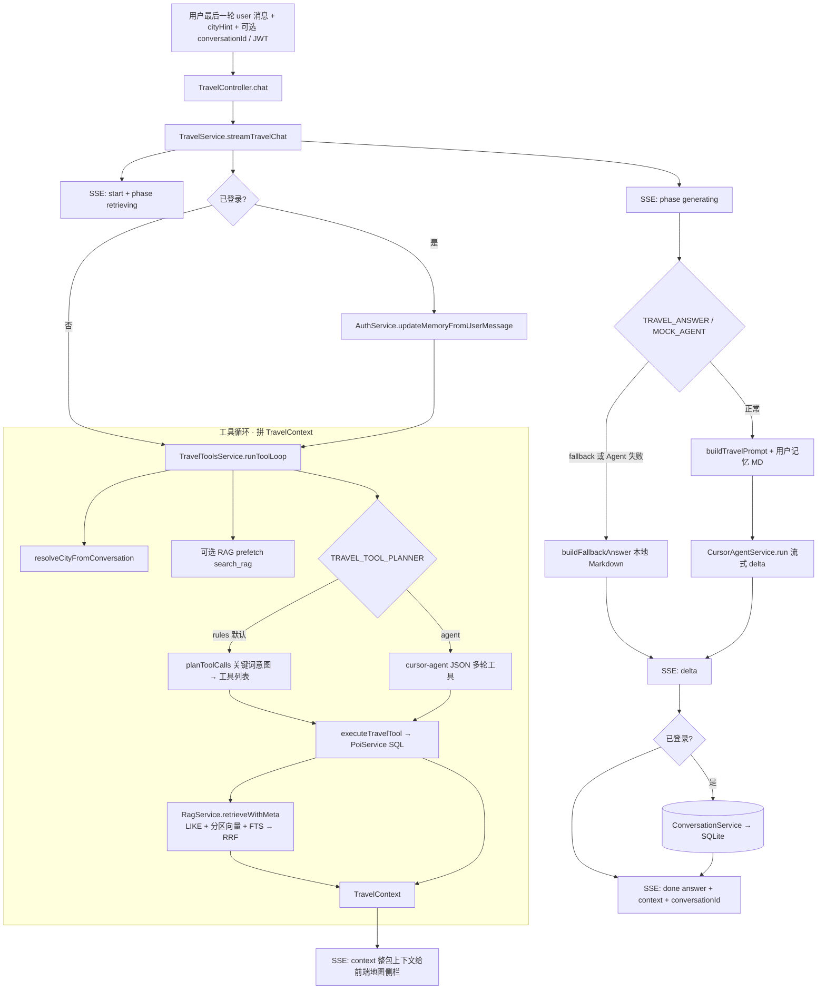

| 阶段 | 耗时特征 | 说明 |
|------|-----------|------|
| **检索** | 通常 <100ms（Mock/本地 TF-IDF） | 规则工具 + RAG 与 POI **并行编排**在 `runToolLoop` 内 |
| **生成** | Mock 瞬时；真实 cursor-agent 数秒～分钟 | `sse.pushDelta` 增量；超时走 `buildFallbackAnswer` |
| **落库** | 毫秒级 | 仅登录用户写 `conversations` / `conversation_messages` |

更细的时序、RAG 子图见下文 [代码流程图](#代码流程图) §2–§4。

### 分词 / 检索词策略

RAG 链路统一走 **nodejieba**（`cutForSearch`，见 `apps/backend/src/travel/rag/jieba-segment.util.ts`）：

| 环节 | 函数 | 策略 |
|------|------|------|
| 抽 **terms** | `extractSearchTerms` | `TRAVEL_KEYWORDS` + 结巴词（≥2 字）；最多 12 条 |
| **LIKE / FTS / TF-IDF** | `segmentTextToTokens` / `formatTextForFtsIndex` / `buildFtsQuery` | 同一套结巴 token；FTS 入库为空格分隔词列（`unicode61`） |
| 语义轨 | 可选 OpenAI embedding | `RAG_EMBEDDING_PROVIDER=openai` 时减轻对稀疏分词的依赖 |

**改分词或 FTS 格式后请 `pnpm db:init` 并提交 `travel.db`**，否则旧索引与新区词不一致。

**可考虑的更优方案（按投入递增）**

| 方案 | 适用场景 | 权衡 |
|------|-----------|------|
| **领域词典** | 快速改进 | 扩充 `TRAVEL_KEYWORDS` + 同义词；与结巴叠加 |
| **2–3 字 n-gram（仅向量路）** | 不配分词库的中间态 | 召回略好，索引变大 |
| **查询改写** | 复杂多句问法 | 用小模型或规则把问句压成 keyword line 再检索；多一次 LLM 延迟 |
| **Embedding 主检索** | 语义相近表述 | 已支持 OpenAI；本地可用 `@xenova/transformers` 等多语言句向量（需评估内存） |
| **Cross-encoder 重排** | RRF 后 Top-K 再精排 | 质量提升明显，线上要多一跳推理 |
| **迁 PG + `pg_trgm` / jieba 外挂 / pgvector** | 多实例、大库 | 与 [MONOREPO.md](docs/MONOREPO.md) 迁 PG 路线一致 |

对本项目 demo 体量，**优先顺序**建议：词典扩展 → 打开 embedding（若有关键）→ 分词库或查询改写；全库变大再加重排与 PG。

## 代码流程图

### 1. 系统分层与模块依赖

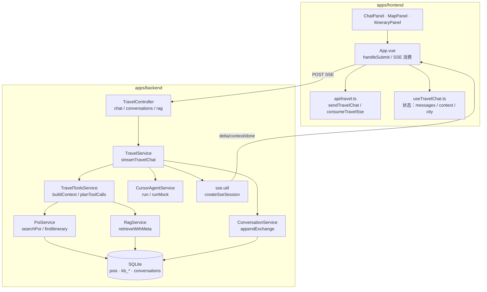

### 2. 旅游聊天完整时序（含核心函数）

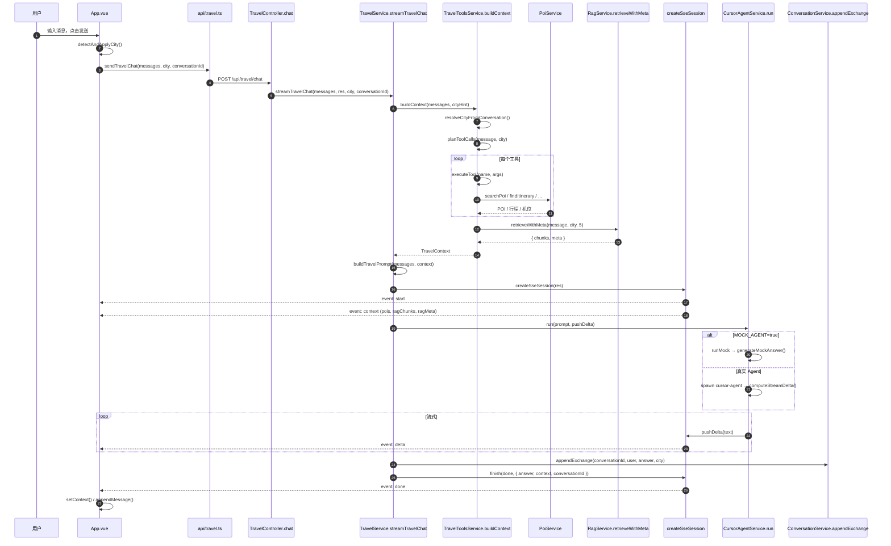

### 3. buildContext 检索编排

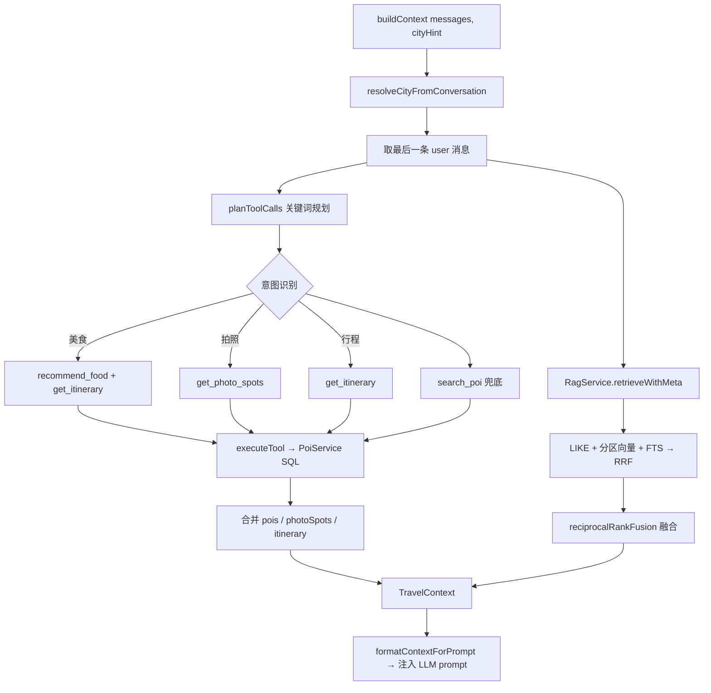

### 4. RAG 混合检索流程（按城市分区优化）

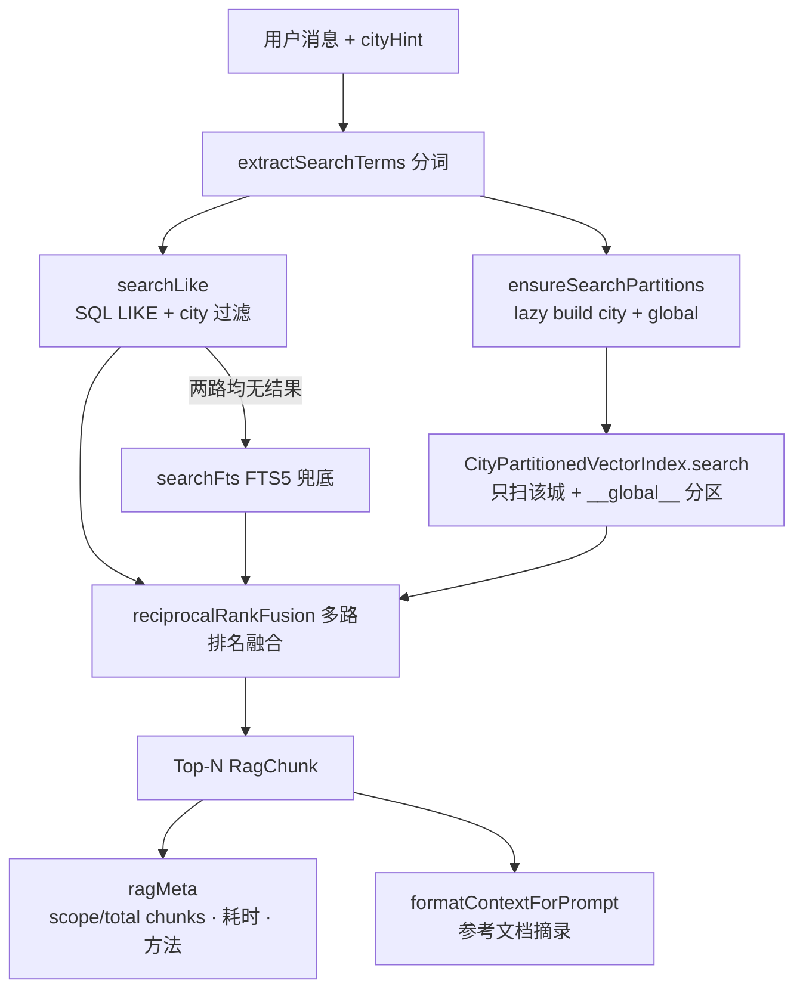

**分区向量索引生命周期：**

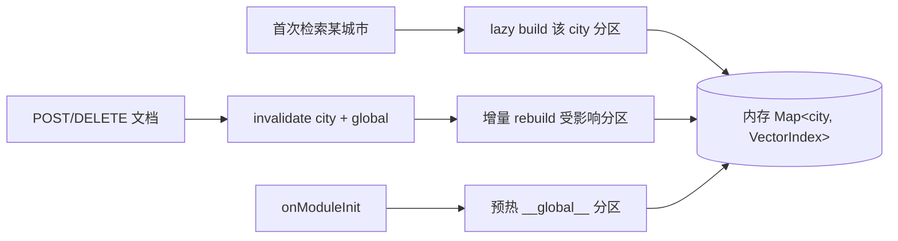

### 5. SSE 流式协议

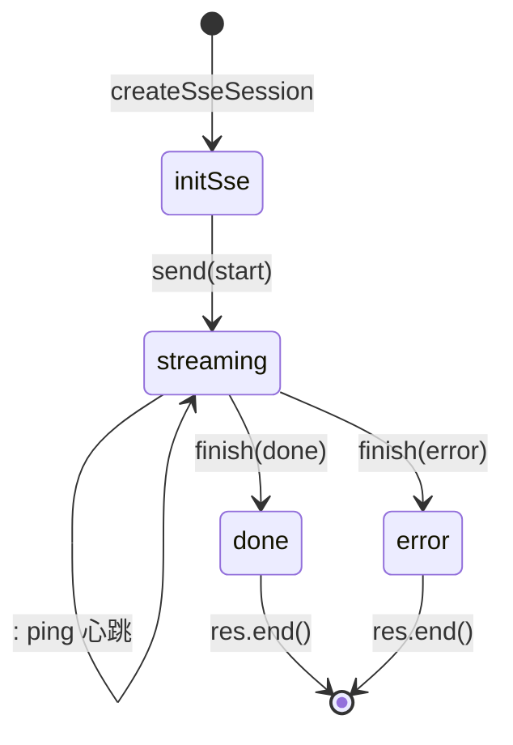

### 6. 前端交互流程

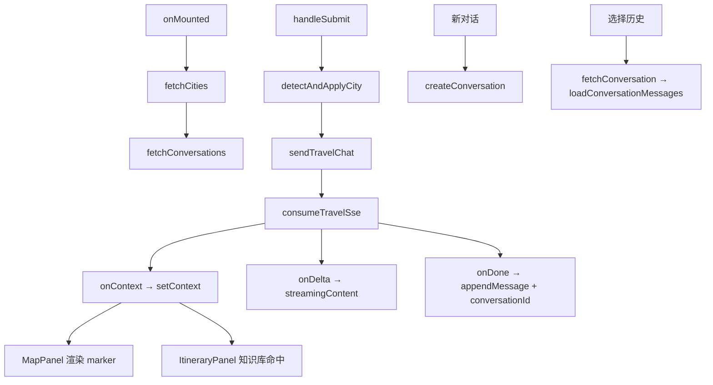

### 7. 对话持久化

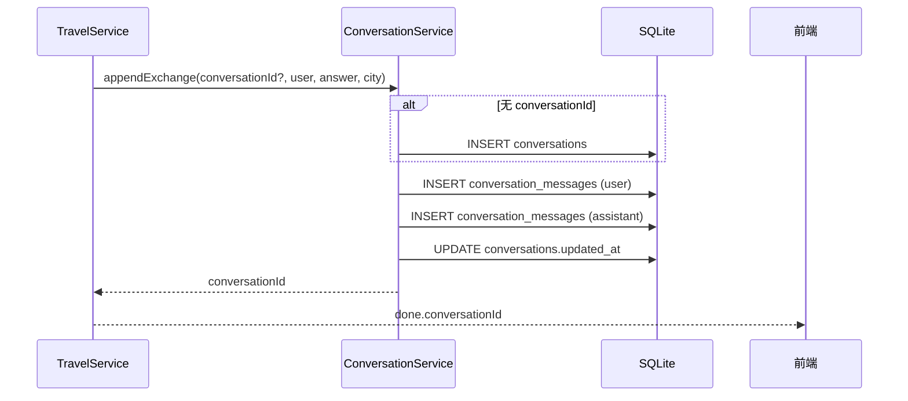

### 8. 核心函数索引

| 层级 | 函数 | 文件 | 职责 |
|------|------|------|------|
| 前端 | `handleSubmit` | `App.vue` | 发消息、消费 SSE、更新 UI |
| 前端 | `consumeTravelSse` | `api/travel.ts` | 解析 SSE 事件流 |
| 前端 | `buildContext` 消费 | `useTravelChat.setContext` | 同步地图/行程/知识库状态 |
| 控制器 | `TravelController.chat` | `travel.controller.ts` | 校验 DTO，委托 `streamTravelChat` |
| 服务 | `streamTravelChat` | `travel.service.ts` | 编排检索 → prompt → Agent → 持久化 |
| 服务 | `buildContext` | `travel-tools.service.ts` | POI 工具链 + RAG 双轨检索 |
| 服务 | `planToolCalls` | `travel-tools.service.ts` | 正则意图 → 工具调用计划 |
| 服务 | `retrieveWithMeta` | `rag.service.ts` | LIKE + 分区 TF-IDF 向量 + FTS + RRF |
| 服务 | `CityPartitionedVectorIndex` | `city-partitioned-vector-index.ts` | 按 city 分区 lazy build / 增量 rebuild |
| 服务 | `run` | `cursor-agent.service.ts` | Mock 或 spawn cursor-agent |
| 工具 | `createSseSession` | `sse.util.ts` | SSE 会话：心跳 + delta + 结束 |
| 工具 | `init-travel-db` | `apps/backend/scripts/init-travel-db.ts` | 从 seed-data 重新生成 travel.db（维护工具） |
| 工具 | `indexDocumentChunks` | `kb-index.util.ts` | 文档分块 + FTS 索引 |
| 持久化 | `appendExchange` | `conversation.service.ts` | 保存一轮 user/assistant |

## 整体架构

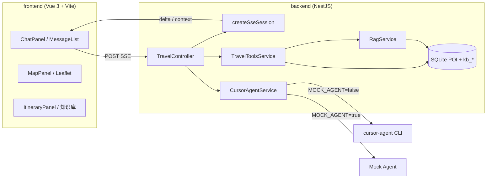

## 旅游聊天请求流（简版）

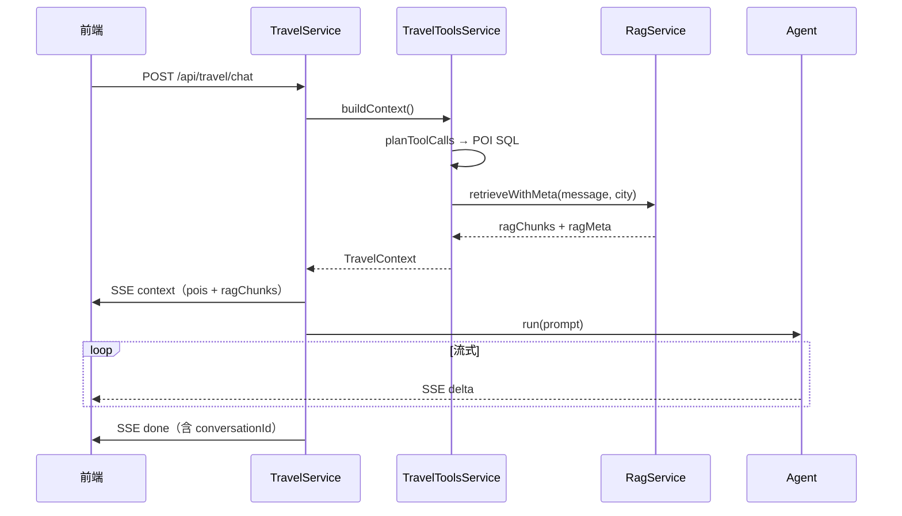

## 优化后的 RAG 流程

RAG 在本项目中的用法：**Retrieve → Augment prompt → Generate**。RAG 只负责检索与注入上下文，最终回答由 cursor-agent（或 Mock）基于完整 prompt 生成。

### 端到端时序

1. 用户发送消息 → `TravelToolsService.buildContext()` 解析城市（`resolveCityFromConversation`）
2. **并行双轨**：POI 工具链（结构化 SQL）+ `RagService.retrieveWithMeta(message, city, 5)`（攻略长文本）
3. 检索结果写入 `TravelContext.ragChunks`，经 `formatContextForPrompt()` 拼入 prompt 的「参考文档摘录（RAG）」段落
4. Agent 流式生成；SSE `context` 事件同时把 `ragChunks` + `ragMeta` 推给前端展示

### 混合检索（三路 + RRF 融合）

每条用户消息会走以下检索路径，最后用 **Reciprocal Rank Fusion（RRF）** 合并排名：

| 路径 | 实现 | 作用 |
|------|------|------|
| **LIKE** | `searchLike()` — SQL `LIKE '%关键词%'` + `city_id` 过滤 | 中文短问句精确命中（如「火锅」「熊猫」） |
| **向量** | `CityPartitionedVectorIndex` — 本地 TF-IDF + 余弦相似度 | 补充语义相近片段（如「微辣」↔「火锅起步」） |
| **FTS** | `searchFts()` — SQLite FTS5 + BM25 | 仅当 LIKE + 向量均无结果时兜底 |

```
用户消息
  → extractSearchTerms()           # 中文 n-gram + 英文词
  → searchLike()                   # SQL 按 city 过滤
  → ensureSearchPartitions()       # lazy build 目标分区
  → CityPartitionedVectorIndex     # 只扫 city + __global__
  → searchFts()                    # 兜底（可选）
  → reciprocalRankFusion()         # 多路排名融合
  → Top-N RagChunk + ragMeta
```

### 多城市优化：按城市分区向量索引

旧设计将全国 chunk 载入单个 `VectorIndex`，城市增多时内存、CPU、写入 rebuild 都会线性恶化。优化后采用 **`CityPartitionedVectorIndex`**：

| 机制 | 说明 |
|------|------|
| **分区** | 每个 `city_id` 独立 TF-IDF 索引 + `__global__` 通用攻略分区 |
| **Lazy build** | 启动只预热 global；首次检索某城市时再 build 该分区 |
| **增量失效** | 文档 upsert/delete 只 rebuild 受影响城市 + global，不再全量重建 |
| **检索范围** | 单次向量扫描 ≈ O(该城 chunk + global chunk)，与全国城市总数解耦 |

OpenAI embedding 调试路径（`?provider=openai`）在 SQL 层按 city 过滤并 `LIMIT 300`，同样避免全国向量扫描。

### 数据层（预置 DB）

完整表结构与 ER 图见上文 [数据库结构](#数据库结构sqlite) 一节。

| 阶段 | 行为 |
|------|------|
| **仓库** | `packages/data/travel.db` 已包含 11 城 POI + 知识库，提交到 Git |
| **启动** | `DatabaseService` 只打开 DB，**不建表、不灌数据** |
| **维护** | 改 `apps/backend/scripts/seed-data/` → `pnpm db:init` → 提交新 db |
| **文档 API** | `POST /api/travel/rag/documents` → 分块 + 增量 rebuild 向量分区 |
| **删除** | `DELETE .../documents/:id` → 删除 chunk + FTS → 增量 rebuild 分区 |

### ragMeta 可观测字段

SSE `context` 中的 `ragMeta` 便于调试与面试演示：

| 字段 | 含义 |
|------|------|
| `durationMs` | 检索耗时 |
| `methods` | 实际命中的路径（`like` / `vector` / `fts` / `hybrid`） |
| `vectorIndexSize` | 本次扫描的分区 chunk 数（city + global） |
| `totalChunks` | 全库 chunk 总数 |
| `vectorPartitions` | 内存中已构建的分区数 |
| `tokenEstimate` | 注入 prompt 的 token 估算 |

日志示例：`scope=12/8500` 表示只扫描 12 个 chunk，全库共 8500 个。

### 与 POI 检索的分工

| 维度 | POI 工具链 | RAG |
|------|-----------|-----|
| 数据形态 | 结构化（名称、坐标、评分） | 非结构化长文本（攻略、避坑） |
| 触发方式 | `planToolCalls` 正则意图规划 | 每条消息自动检索 |
| 典型内容 | 景点列表、行程表、机位 | 「火锅怎么选」「熊猫几点去」 |
| 注入位置 | `### POI 列表` / `### 参考行程` | `### 参考文档摘录（RAG）` |

更详细的 API、Prompt 示例与扩展指南见 [docs/RAG.md](docs/RAG.md)。

## SSE 事件协议

| 事件 | 发送方 | 用途 |
|------|--------|------|
| `start` | Chat / Travel | 流已开始 |
| `context` | Travel only | POI、机位、行程、**ragChunks** |
| `delta` | Chat / Travel | AI 增量文本 `{ text }` |
| `done` | Chat / Travel | 完成 `{ answer, context? }` |
| `error` | Chat | 失败 `{ error }` |
| `: ping` | createSseSession | 8s 心跳保活 |

## API 一览

| 方法 | 路径 | 说明 |
|------|------|------|
| GET | `/api/travel/health` | 旅游模块 + RAG + cursor-agent 状态 |
| GET | `/api/travel/cities` | 城市列表 |
| GET | `/api/travel/rag/documents` | 知识库文档列表 |
| POST | `/api/travel/chat` | 旅游聊天 SSE（POI + RAG） |
| GET | `/api/travel/conversations` | 对话列表 |
| POST | `/api/travel/conversations` | 创建对话 |
| GET | `/api/travel/conversations/:id` | 对话详情 + 消息 |
| DELETE | `/api/travel/conversations/:id` | 删除对话 |
| POST | `/api/travel/rag/documents` | 创建/更新知识库文档并 reindex |
| DELETE | `/api/travel/rag/documents/:id` | 删除知识库文档 |

## 第三阶段能力

| 能力 | 说明 |
|------|------|
| **对话持久化** | SQLite `conversations` / `conversation_messages`，聊天完成后自动保存 |
| **知识库管理** | POST/DELETE 文档 API + 前端「添加文档」表单，自动分块索引 |
| **E2E 测试** | Playwright：发消息 → 地图 marker → 知识库命中 |

## 配置项（`.env`）

| 变量 | 默认 | 说明 |
|------|------|------|
| `MOCK_AGENT` | false（example 为 true） | true = 不调 cursor-agent，演示模式 |
| `RAG_EMBEDDING_PROVIDER` | tfidf | 本地向量；`openai` 需 API Key + 回填 embedding |
| `OPENAI_API_KEY` | — | OpenAI embedding（可选） |
| `PORT` | 3000 | 监听端口 |
| `HOST` | 127.0.0.1 | 监听地址 |
| `CURSOR_AGENT_COMMAND` | cursor-agent | CLI 可执行名或路径 |
| `CURSOR_USE_API_KEY` | false | 是否使用 API Key |
| `CURSOR_API_KEY` | — | API Key |
| `CURSOR_TIMEOUT_MS` | 300000 | 总超时 |
| `CURSOR_STALL_MS` | 45000 | 无输出超时 |
| `TRAVEL_DB_PATH` | packages/data/travel.db | SQLite 路径 |

## 测试

```bash
pnpm test       # turbo → Jest 单元测试（含 backend 集成）
pnpm test:e2e   # Playwright E2E（自动 build + 启动 Mock 服务）
```

CI：`.github/workflows/ci.yml`（unit test + build + E2E）。

## 技术决策（面试可讲）

- **SSE vs WebSocket**：单向 AI 流足够，SSE 更简单、易过 HTTP 代理
- **LIKE 优先于 FTS**：中文短问句在 SQLite FTS 分词不稳定
- **预置 SQLite**：POI/KB 数据在 `packages/data/travel.db`，启动只连接、不建表/不迁移；schema 变更靠 `db:init` + 提交 db
- **向量按城市分区**：lazy build + 增量 rebuild，避免全国 chunk 全量扫描
- **Mock 在 Agent 层**：POI/RAG 仍真实，保证 demo 与生产路径一致
- **Agent 失败兜底**：`TravelService.buildFallbackAnswer` 仍可用本地 Markdown 回复

## 扩展指南

1. **新增城市/POI**：编辑 `apps/backend/scripts/seed-data/seed-data.cities.ts` → `pnpm db:init` → 提交 `packages/data/travel.db`
2. **新增 RAG 文档**：编辑 `apps/backend/scripts/seed-data/seed-data.kb.ts` 后同上；或通过 `POST /api/travel/rag/documents` 运行时写入
3. **换 LLM**：替换 `CursorAgentService.run`，SSE 层无需改动

更详细的后端目录说明见 [apps/backend/ARCHITECTURE.md](apps/backend/ARCHITECTURE.md)。核心函数均含中文 JSDoc，可直接在 IDE 中 hover 查看。
