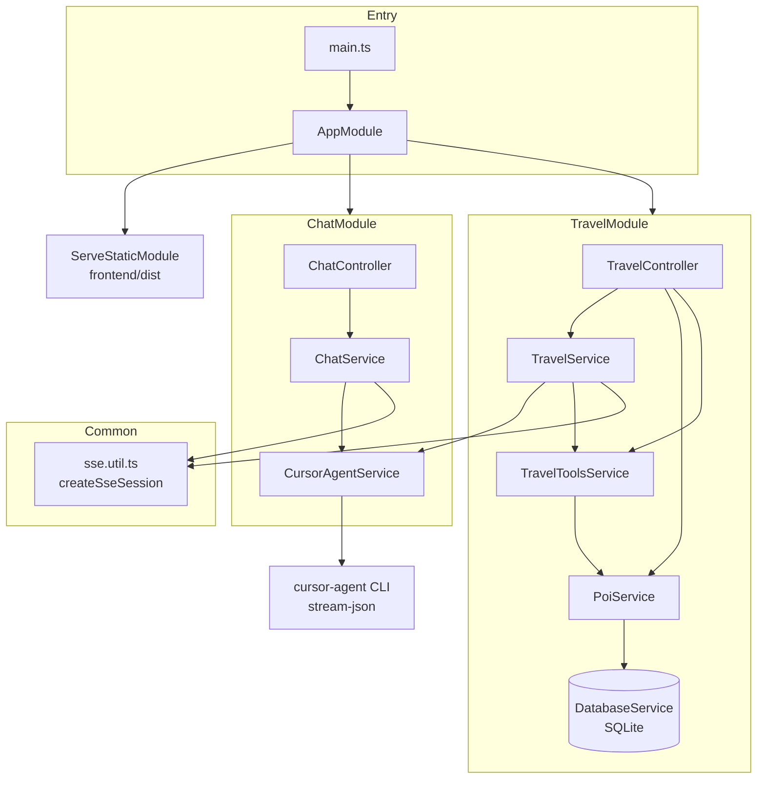
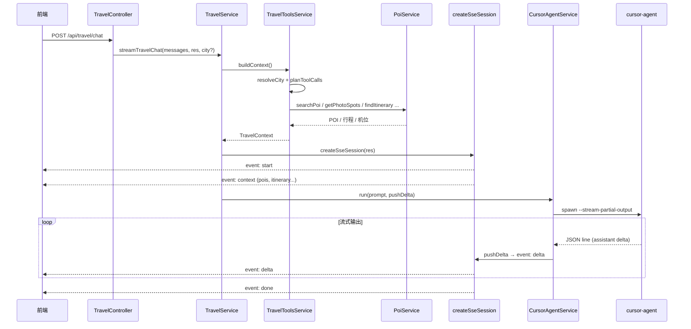
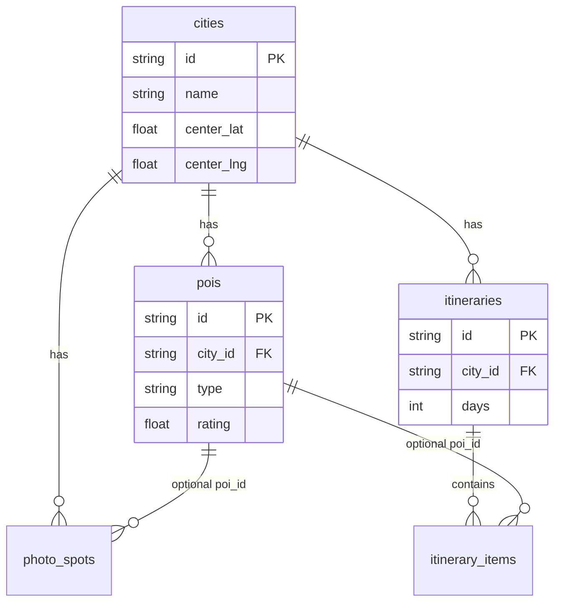

# 后端架构

NestJS 11 单体应用，提供通用聊天与 AI 旅游助手两套 API，通过 SSE 流式返回 AI 回复。

> 全栈架构图与 API 一览见根目录 [README.md](../README.md)。

## 目录结构

```
backend/src/
├── main.ts                 # 启动入口、全局 ValidationPipe
├── app.module.ts           # 根模块：Config、Chat、Travel、静态前端
├── agent/
│   └── agent.constants.ts  # ChatMessage 类型、通用 SYSTEM_PROMPT
├── common/
│   └── sse.util.ts         # SSE 协议封装（init / send / session / 兜底分块）
├── chat/                   # 通用聊天模块
│   ├── chat.controller.ts
│   ├── chat.service.ts
│   ├── cursor-agent.service.ts   # prompt 构建 + spawn 子进程
│   └── chat.module.ts
└── travel/                 # 旅游助手模块
    ├── travel.controller.ts
    ├── travel.service.ts         # SSE 流 + prompt + 兜底回复
    ├── travel-tools.service.ts   # 工具规划 + 上下文检索 + 格式化
    ├── travel.constants.ts
    ├── poi.service.ts
    ├── database/
    │   ├── database.service.ts # 打开预置 travel.db
    │   ├── sql-fragments.ts    # COUNT、KB city scope 等 SQL 片段
    │   ├── json-column.util.ts # JSON 数组列解析
    │   ├── kb-chunk-index.ts   # KB 分块写入（脚本 + Repository 共用）
    │   └── repositories/       # POI / KB / Conversation 数据访问层
    └── scripts/
        ├── init-travel-db.ts   # 从 seed-data 生成 travel.db
        └── seed-data/          # POI + KB 种子（非运行时依赖）
    └── travel.module.ts
```

## 模块依赖



## 请求流：旅游聊天



## SSE 事件协议

| 事件 | 发送方 | 用途 |
|------|--------|------|
| `start` | Chat / Travel | 流已开始 |
| `context` | Travel only | POI、机位、行程（前端提前渲染） |
| `delta` | Chat / Travel | AI 增量文本 `{ text }` |
| `done` | Chat / Travel | 完成 `{ answer, context? }` |
| `error` | Chat | 失败 `{ error }` |
| `: ping` | createSseSession | 8s 心跳保活（SSE 注释行） |

## 数据层



- 数据库文件：`data/travel.db`（可通过 `TRAVEL_DB_PATH` 覆盖）
- 启动时自动 schema + 增量迁移 + 补种缺失城市

## API 一览

| 方法 | 路径 | 说明 |
|------|------|------|
| GET | `/api/health` | cursor-agent 健康信息 |
| POST | `/api/chat` | 通用聊天 SSE |
| GET | `/api/travel/health` | 旅游模块状态 |
| GET | `/api/travel/cities` | 城市列表 |
| GET | `/api/travel/food-guide?city=` | 美食攻略 |
| GET | `/api/travel/map-markers?city=` | 地图标记 |
| GET | `/api/travel/pois` | POI 搜索 |
| POST | `/api/travel/chat` | 旅游聊天 SSE |

## 配置项（`.env`）

| 变量 | 默认 | 说明 |
|------|------|------|
| `PORT` | 3000 | 监听端口 |
| `HOST` | 127.0.0.1 | 监听地址 |
| `CURSOR_AGENT_COMMAND` | cursor-agent | CLI 命令 |
| `CURSOR_USE_API_KEY` | false | 是否使用 API Key 认证 |
| `CURSOR_API_KEY` | — | API Key（无效会导致长时间无响应） |
| `CURSOR_TIMEOUT_MS` | 300000 | 总超时 |
| `CURSOR_STALL_MS` | 45000 | 无输出超时 |
| `MAX_HISTORY_MESSAGES` | 20 | 对话历史上限 |
| `TRAVEL_DB_PATH` | data/travel.db | SQLite 路径 |

## 扩展建议

1. **新增城市/POI**：编辑 `scripts/seed-data/seed-data.cities.ts` → `npm run db:init` → 提交 `data/travel.db`
2. **新增工具**：在 `travel.constants.ts` 注册定义，`TravelToolsService.executeTool` 增加分支，`planToolCalls` 补充触发规则
3. **换 LLM**：替换 `CursorAgentService.run` 的实现，SSE 层（`createSseSession`）无需改动
