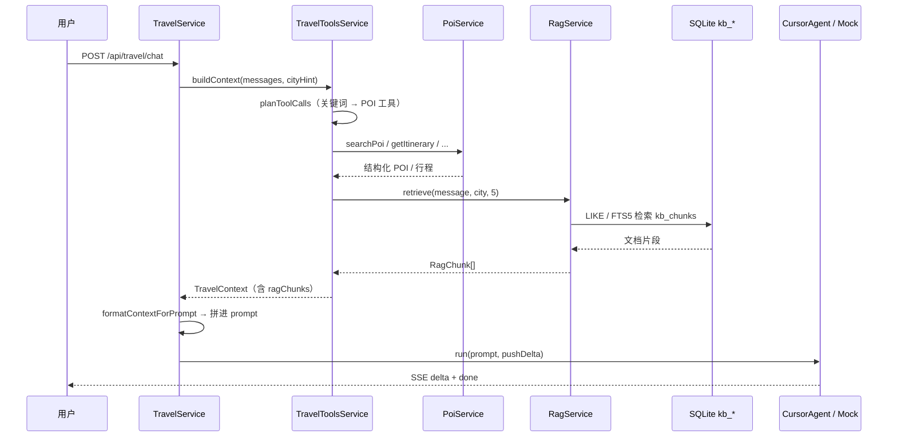

# RAG 使用说明

本项目中的 RAG（Retrieval-Augmented Generation）指：**在用户提问时，从知识库检索相关文档片段，注入 LLM prompt，再生成回答**。

---

## 1. 整体流程



**要点：RAG 不负责生成答案，只负责「检索 + 注入上下文」。** 最终回答由 cursor-agent（或 Mock 模式）基于完整 prompt 生成。

---

## 2. 数据存储

| 表 | 作用 |
|----|------|
| `kb_documents` | 原始攻略文档（标题、城市、全文） |
| `kb_chunks` | 文档分块（约 380 字/块，段落优先） |
| `kb_chunks_fts` | FTS5 虚拟表，辅助英文/分词检索 |

种子数据维护在 `backend/scripts/seed-data/`（POI + KB 文本）。**运行时**直接读取仓库中的 `data/travel.db`；需要更新基础数据时执行 `npm run db:init` 重新生成并提交。

---

## 3. 检索策略（混合 RAG）

```
用户消息
  → extractSearchTerms()
  → searchLike()                    # 中文关键词 LIKE（SQL 按 city 过滤）
  → CityPartitionedVectorIndex      # 按城市分区 TF-IDF，只扫 city + global
  → searchFts()                     # LIKE+向量均无结果时 FTS5 兜底
  → reciprocalRankFusion()          # RRF 融合多路排名
  → 返回 Top-N + RagRetrieveMeta（耗时、方法、scope/total chunks、token 估算）
```

### 多城市扩展：向量索引分区

旧设计将**全国所有 chunk** 载入单个 `VectorIndex`，城市增多时会出现：

| 问题 | 表现 |
|------|------|
| 内存 | O(全库 chunk 数) 常驻 |
| CPU | 每次向量检索遍历全国文档再 filter city |
| 写入 | 任意文档 upsert/delete 触发全量 rebuild |

当前实现改为 **`CityPartitionedVectorIndex`**：

- 每个 `city_id` 独立分区 + `__global__` 通用攻略分区
- **Lazy build**：启动只预热 global；首次检索某城市时再 build 该分区
- **增量失效**：文档变更只 rebuild 受影响城市 + global
- 检索复杂度 ≈ O(该城 chunk + global chunk)，与全国城市总数解耦

OpenAI embedding 路径在 SQL 层按 city 过滤并 `LIMIT 300`，避免全国向量扫描。

可选 **OpenAI embedding**：设置 `RAG_EMBEDDING_PROVIDER=openai`，运行 `npm run rag:embed -w backend` 回填向量，用 `/api/travel/rag/search?provider=openai` 调试。

**为什么 LIKE + 向量？** LIKE 精确命中关键词；TF-IDF 向量补充语义相近片段（如「微辣」↔「火锅起步」），RRF 融合比单路更稳。

---

## 4. 与 POI 检索的分工

| 维度 | POI 工具链 | RAG |
|------|-----------|-----|
| 数据形态 | 结构化（名称、坐标、评分） | 非结构化长文本（攻略、避坑） |
| 触发方式 | `planToolCalls` 正则规划 | 每条消息自动 `retrieve` |
| 典型内容 | 景点列表、行程表、机位 | 「火锅怎么选」「熊猫几点去」 |
| 注入位置 | `### POI 列表` / `### 参考行程` | `### 参考文档摘录（RAG）` |

两者在 `buildContext()` 中并行执行，合并为同一个 `TravelContext`，再统一格式化为 prompt。

---

## 5. Prompt 注入示例

`TravelToolsService.formatContextForPrompt()` 会把 RAG 结果写入：

```markdown
### 参考文档摘录（RAG）
- **成都美食与火锅指南**
  成都火锅分牛油红锅与清油锅。初来建议微辣起步...
```

LLM 被指示「基于上面的数据回答」，从而减少幻觉、增加可溯源性。

---

## 6. 前端展示

- **SSE `context` 事件**：携带 `ragChunks` + `ragMeta`（耗时、检索方法、token 估算）
- **右侧「知识库」Tab**：`GET /api/travel/rag/documents` 列出全部文档
- **搜索调试**：`GET /api/travel/rag/search?q=火锅&city=chengdu`

---

## 7. 相关 API

| 方法 | 路径 | 说明 |
|------|------|------|
| GET | `/api/travel/rag/documents?city=` | 文档列表 |
| GET | `/api/travel/rag/documents/:id` | 文档详情 + 分块 |
| GET | `/api/travel/rag/search?q=&city=&limit=` | 独立检索（调试） |
| POST | `/api/travel/rag/documents` | 创建/更新文档并 reindex |
| DELETE | `/api/travel/rag/documents/:id` | 删除文档 |
| GET | `/api/travel/health` | 含 `rag: { documents, chunks }` |

### 对话持久化

| 方法 | 路径 | 说明 |
|------|------|------|
| GET | `/api/travel/conversations` | 对话列表 |
| POST | `/api/travel/conversations` | 创建对话 |
| GET | `/api/travel/conversations/:id` | 消息历史 |
| DELETE | `/api/travel/conversations/:id` | 删除 |

聊天请求可传 `conversationId`，`done` 事件返回持久化 id。

---

## 8. 扩展 RAG

1. **新增文档**：编辑 `backend/scripts/seed-data/seed-data.kb.ts` → `npm run db:init`；或使用 POST 入库 API
2. **向量检索**：在 `retrieve()` 中增加 embedding 相似度，与 LIKE 做混合排序
3. **引用 UI**：前端在 AI 回复旁展示 `documentTitle` 链接
4. **覆盖补全**：为扬州、洛阳等 POI 已有但 KB 缺失的城市补 seed

---

## 9. 关键源码索引

| 文件 | 职责 |
|------|------|
| `travel-tools.service.ts` | `buildContext` 调用 RAG；`formatContextForPrompt` 注入 |
| `rag/rag.service.ts` | 检索、文档列表、统计 |
| `rag/rag.util.ts` | 分块、关键词提取、FTS query |
| `backend/scripts/init-travel-db.ts` | 从 seed-data 生成 travel.db |
| `backend/scripts/seed-data/seed-data.kb.ts` | KB 种子文档（维护用） |
| `backend/scripts/seed-data/seed-data.cities.ts` | 城市 POI/行程种子（维护用） |
| `database/schema.ts` | `kb_*` 表定义 |
